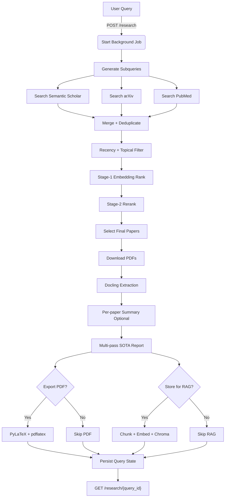

# Mini-Perplexity

FastAPI-based academic research assistant for paper discovery, ranking, evidence-grounded report generation, PDF export, and optional RAG storage.

## Scope
This README documents the FastAPI pipeline only.

## Current API Pipeline

1. Receive query via `POST /research`.
2. Expand query into close subqueries.
3. Search Semantic Scholar, arXiv, and PubMed.
4. Deduplicate, apply recency/topical filtering, and rank with a two-stage ranker:
   - Stage 1: embedding-based scoring (field-aware and multi-query).
   - Stage 2: optional reranking on top candidates.
5. For selected papers: download PDF (if available), extract with Docling, and optionally summarize per paper.
6. Build report with a multi-pass internal flow:
   - evidence-card extraction
   - outline planning
   - section-by-section writing
   - verification and targeted repair
   - bottom-line synthesis
7. Export final report to PDF (`pdflatex` via PyLaTeX).
8. Optionally ingest full text into Chroma for `/rag/query`.

Detailed pipeline reference: [docs/non_cli_pipeline.md](docs/non_cli_pipeline.md)

## Architecture



## API Endpoints

| Method | Endpoint | Description |
|---|---|---|
| POST | `/research` | Start async research pipeline |
| GET | `/research/{query_id}` | Get job status and result |
| GET | `/history` | List past research jobs |
| GET | `/export/{query_id}` | Download generated PDF |
| POST | `/rag/query` | Query stored paper chunks |
| GET | `/rag/stats` | RAG collection stats |
| DELETE | `/rag/paper/{paper_id}` | Delete one paper from RAG |
| DELETE | `/rag/clear` | Clear all RAG documents |

## `POST /research` Request

```json
{
  "query": "what changed in attention mechanism from attention is all you need to now",
  "options": {
    "summarize": true,
    "store_for_rag": true,
    "export_pdf": true
  }
}
```

## Key Runtime Controls (Environment Variables)

### Retrieval and Ranking
- `SEARCH_PER_SUBQUERY_LIMIT` (default `30`)
- `FINAL_PAPER_LIMIT` (default `8`)
- `RECENT_PAPER_YEARS` (default `2`)
- `EMBEDDING_MODEL` (default `embeddinggemma`)
- `TWO_STAGE_RANKING` (default `true`)
- `RERANK_MODEL` (default `bge-reranker-v2-m3`)

### Report Generation
- `REPORT_MULTI_STAGE` (default `true`)
- `REPORT_MIN_WORDS` (default `900`)
- `REPORT_MAX_WORDS` (default `1400`)
- `REPORT_SECTION_TARGET_WORDS` (default `150`)
- `REPORT_VERIFICATION_ENABLED` (default `true`)
- `REPORT_STRUCTURED_MODEL` (default `gpt-oss:20b`)
- `REPORT_WRITER_MODEL` (default `gpt-oss:20b`)
- `REPORT_VERIFIER_MODEL` (default `gpt-oss:20b`)

### Extraction and Export
- `DOCLING_MAX_PAGES` (default `4`)
- `REPORT_INCLUDE_ARTIFACTS` (default `false`)

## Local Run

### Requirements
- Python `3.12+`
- Ollama running locally
- TeX installation with `pdflatex` available in `PATH`

### Install

```bash
cd /home/yuguerten/workspace/mini-perplexity
python -m venv .venv
. .venv/bin/activate
pip install -e .
```

### Pull required models (example)

```bash
ollama pull gpt-oss:20b
ollama pull embeddinggemma
```

### Run API

```bash
.venv/bin/python -m uvicorn src.api.main:app --host 127.0.0.1 --port 8000 --reload
```

## Quick API Test

```bash
curl -X POST "http://127.0.0.1:8000/research" \
  -H "Content-Type: application/json" \
  --data-raw '{"query":"what changed in attention mechanism from attention is all you need to now","options":{"summarize":true,"store_for_rag":true,"export_pdf":true}}'
```

Then poll:

```bash
curl "http://127.0.0.1:8000/research/<QUERY_ID>"
```

## Storage Layout

- `data/queries/`: research job state JSON
- `data/papers/`: downloaded PDFs
- `data/exports/`: generated report PDFs
- `data/chroma/`: Chroma persistence for RAG
