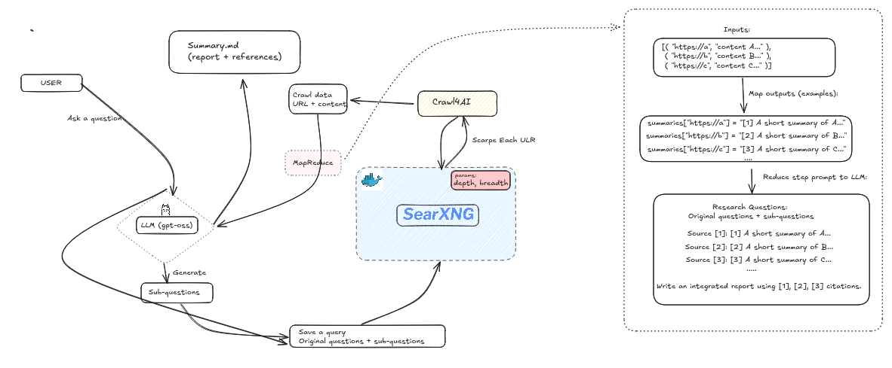

# Mini-Perplexity

A CLI research assistant powered by local LLMs (via Ollama) and web search (via SearXNG).



---

## Current Architecture (v1.0)

```
┌─────────────────────────────────────────────────────────────────────────────┐
│                              USER LAYER                                      │
├─────────────────────────────────────────────────────────────────────────────┤
│                                                                             │
│   ┌─────────────────────────────────────────────────────────────────────┐   │
│   │                          CLI (Rich UI)                               │   │
│   │                  src/cli.py - Main entry point                      │   │
│   └─────────────────────────────────────────────────────────────────────┘   │
│                                      │                                       │
└──────────────────────────────────────┼───────────────────────────────────────┘
                                       │
                                       ▼
┌─────────────────────────────────────────────────────────────────────────────┐
│                            CORE LAYER                                        │
├─────────────────────────────────────────────────────────────────────────────┤
│                                                                             │
│   ┌─────────────────────┐              ┌─────────────────────┐              │
│   │   ollama_client.py  │              │  searx_client.py   │              │
│   │                     │              │                     │              │
│   │   • Generate text  │              │   • Search web     │              │
│   │   • Chat completions│              │   • Crawl pages   │              │
│   │   • Prompt templates│              │   • Extract content│              │
│   └──────────┬──────────┘              └──────────┬──────────┘              │
│              │                                        │                        │
│              ▼                                        ▼                        │
│   ┌─────────────────────────────────────────────────────────────────────┐   │
│   │                    OUTPUT: Markdown Reports                          │   │
│   │               summaries_{uuid}.md + crawled_content.txt             │   │
│   └─────────────────────────────────────────────────────────────────────┘   │
│                                                                             │
└─────────────────────────────────────────────────────────────────────────────┘
              │
              ▼
┌─────────────────────────────────────────────────────────────────────────────┐
│                            DATA LAYER                                        │
├─────────────────────────────────────────────────────────────────────────────┤
│                                                                             │
│   ┌─────────────────┐         ┌─────────────────┐        ┌──────────────┐   │
│   │    SearXNG     │         │    crawl4ai    │        │    Ollama    │   │
│   │  (Docker)      │         │    (Local)     │        │   (Local)    │   │
│   │                 │         │                │        │               │   │
│   │  • Web search   │         │  • Page crawl  │        │  • LLM model │   │
│   │  • Results      │         │  • HTML parse  │        │  • Reasoning │   │
│   └─────────────────┘         └─────────────────┘        └──────────────┘   │
│                                                                             │
└─────────────────────────────────────────────────────────────────────────────┘
```

---

## Academic Research Assistant (v2.0) - PROPOSED

```
┌─────────────────────────────────────────────────────────────────────────────┐
│                              USER INTERFACE                                  │
├─────────────────────────────────────────────────────────────────────────────┤
│                                                                             │
│   ┌──────────────┐   ┌──────────────┐                                       │
│   │  CLI (Rich)  │   │  FastAPI API │                                       │
│   │  (Existing)  │   │   (NEW)      │                                       │
│   └──────┬───────┘   └──────┬───────┘                                       │
│          │                   │                                               │
└──────────┼───────────────────┼───────────────────────────────────────────────┘
           │                   │
           ▼                   ▼
┌─────────────────────────────────────────────────────────────────────────────┐
│                             CORE LAYER                                       │
├─────────────────────────────────────────────────────────────────────────────┤
│                                                                             │
│   ┌─────────────────────────────────────────────────────────────────────┐   │
│   │                     API Gateway (FastAPI)                          │   │
│   │                                                                        │   │
│   │   POST /research     - Async: Start research → returns query_id    │   │
│   │   GET  /research/{id} - Get status & result                         │   │
│   │   POST /rag/query    - Q&A over stored papers                        │   │
│   │   GET  /history      - List past queries                            │   │
│   └────────────────────────────────┬────────────────────────────────────┘   │
│                                    │                                          │
│   ┌────────────────────────────────┼────────────────────────────────────┐   │
│   │                        SERVICE LAYER                                │   │
│   │                                                                        │   │
│   │   ┌─────────────┐   ┌─────────────┐   ┌─────────────┐              │   │
│   │   │  Research   │   │    RAG      │   │   Export   │              │   │
│   │   │  Service    │   │   Service   │   │  Service   │              │   │
│   │   │              │   │             │   │            │              │   │
│   │   │ • Search    │   │• Doc-Struct │   │• Markdown  │              │   │
│   │   │ • Fetch     │   │   Chunking  │   │• Compile   │              │   │
│   │   │ • Download  │   │• Embedding  │   │• PDF       │              │   │
│   │   │ • Extract   │   │• Vector DB  │   │ (weasy)    │              │   │
│   │   │ • Summarize │   │• Query      │   │            │              │   │
│   │   └─────────────┘   └─────────────┘   └─────────────┘              │   │
│   │                                                                        │   │
│   │                              ▼                                   │      │   │
│   │   ┌─────────────────────────────────────────────────────────────┐│      │   │
│   │   │                    OUTPUT: PDF (Compiled)                   ││      │   │
│   │   │                  (markdown → PDF via weasyprint)           ││      │   │
│   │   └─────────────────────────────────────────────────────────────┘│      │   │
│   │                                                                    │      │   │
│   └────────────────────────────────────────────────────────────────────┘      │
│                                                                             │
└─────────────────────────────────────────────────────────────────────────────┘
              │
              ▼
┌─────────────────────────────────────────────────────────────────────────────┐
│                            DATA LAYER                                        │
├─────────────────────────────────────────────────────────────────────────────┤
│                                                                             │
│   ┌─────────────────────────────────────────────────────────────────────┐   │
│   │                    ACADEMIC PAPER SOURCES                          │   │
│   │                                                                       │   │
│   │   ┌────────────┐   ┌────────────┐   ┌────────────┐   ┌─────────┐  │   │
│   │   │  Semantic  │   │   arXiv    │   │   PubMed   │   │  CORE   │  │   │
│   │   │  Scholar   │   │    API     │   │    API     │   │   API   │  │   │
│   │   │    API     │   │            │   │            │   │         │  │   │
│   │   └─────┬──────┘   └─────┬──────┘   └─────┬──────┘   └────┬────┘  │   │
│   │         │                │                │               │        │   │
│   │         └────────────────┼────────────────┼───────────────┘        │   │
│   │                          │                │                        │   │
│   │                          ▼                ▼                         │   │
│   │   ┌─────────────────────────────────────────────────────────────────┐ │   │
│   │   │              PAPER PROCESSING PIPELINE                        │ │   │
│   │   │                                                                  │ │   │
│   │   │   ┌──────────┐    ┌──────────┐    ┌──────────┐    ┌────────┐│ │   │
│   │   │   │ Download │───▶│  Docling │───▶│  Chunk   │───▶│Embed   ││ │   │
│   │   │   │  (PDF)   │    │  Extract │    │(Section) │    │(BGE-M3)││ │   │
│   │   │   └──────────┘    └──────────┘    └──────────┘    └────┬───┘│ │   │
│   │   │                                                    │        │ │   │
│   │   │                                              ┌─────▼─────┐   │ │   │
│   │   │                                              │  ChromaDB │   │ │   │
│   │   │                                              │  / FAISS  │   │ │   │
│   │   │                                              └───────────┘   │ │   │
│   │   │                                                                  │ │   │
│   │   │   ┌──────────────────────────────────────────────────────────┐ │ │   │
│   │   │   │              STORAGE (SQLite/JSON)                       │ │ │   │
│   │   │   │   • queries/     - User query history                    │ │ │   │
│   │   │   │   • papers/      - Downloaded PDFs                      │ │ │   │
│   │   │   │   • summaries/   - Generated summaries                   │ │ │   │
│   │   │   │   • exports/     - Exported PDFs                        │ │ │   │
│   │   │   └──────────────────────────────────────────────────────────┘ │ │   │
│   │   │                                                                  │ │   │
│   │   └─────────────────────────────────────────────────────────────────┘ │   │
│   │                                                                       │   │
│   └───────────────────────────────────────────────────────────────────────┘   │
│                                                                             │
└─────────────────────────────────────────────────────────────────────────────┘
              │
              ▼
┌─────────────────────────────────────────────────────────────────────────────┐
│                          LLM LAYER (Local)                                   │
├─────────────────────────────────────────────────────────────────────────────┤
│                                                                             │
│   ┌─────────────────────────────────────────────────────────────────────┐   │
│   │                         OLLAMA (Local)                              │   │
│   │                                                                       │   │
│   │   ┌──────────────────┐  ┌──────────────────┐  ┌──────────────────┐  │   │
│   │   │   DeepSeek-R1    │  │      Qwen        │  │     Llama3      │  │   │
│   │   │  (Summarization) │  │   (Comparison)  │  │    (Q&A/RAG)    │  │   │
│   │   └──────────────────┘  └──────────────────┘  └──────────────────┘  │   │
│   │                                                                       │   │
│   │   ┌─────────────────────────────────────────────────────────────────┐ │   │
│   │   │                    Prompt Templates                           │ │   │
│   │   │  • Academic Summary    • Literature Review    • Paper Critique │ │   │
│   │   │  • TL;DR Generation    • Methodology Analysis                 │ │   │
│   │   └─────────────────────────────────────────────────────────────────┘ │   │
│   │                                                                       │   │
│   └───────────────────────────────────────────────────────────────────────┘   │
│                                                                             │
└─────────────────────────────────────────────────────────────────────────────┘
```

---

## API Endpoints

| Method | Endpoint | Description |
|--------|----------|-------------|
| POST | `/research` | Async: Start research pipeline → returns `query_id` |
| GET | `/research/{id}` | Get status & result (polls until complete) |
| POST | `/rag/query` | Q&A over stored papers |
| GET | `/history` | List past queries |

### Request/Response Flow

```
POST /research
    │
    ▼ (returns immediately)
{
  "query_id": "uuid-1234",
  "status": "processing"
}
    │
    ▼ (poll)
GET /research/uuid-1234
    │
    ▼ (until status="completed")
{
  "query_id": "uuid-1234",
  "status": "completed",
  "papers": [...],
  "summary": "...",
  "pdf_path": "exports/uuid-1234.pdf"
}
```

### POST /research Body

```python
{
  "query": "machine learning transformers",
  "options": {
    "max_papers": 5,
    "summarize": True,
    "store_for_rag": True,
    "export_pdf": True
  }
}
```

---

## Features

- **Interactive Research**: Asks clarifying questions to understand your research needs
- **Web Search**: Uses SearXNG to find relevant sources across the web
- **Content Extraction**: Crawls and summarizes web pages using crawl4ai
- **Local LLM**: Uses Ollama with a predefined model by the user
- **Markdown Reports**: Generates research reports with citations and references

## Quick Start

1. **Start SearXNG (search engine):**
   ```bash
   bash scripts/searx-docker.sh start
   ```

2. **Setup crawl4ai (web crawler):**
   ```bash
   bash scripts/setup_crawl4ai.sh
   ```

3. **Run the assistant:**
   ```bash
   uv run src/cli.py
   ```

## Requirements

- Python 3.12+
- Docker & Docker Compose
- Ollama with deepseek-r1:1.5b model installed
- uv package manager

## Usage

After running `uv run src/cli.py`, the assistant will:
1. Ask what you want to research
2. Ask up to 3 clarifying questions
3. Search the web using SearXNG
4. Crawl and summarize relevant pages
5. Generate a markdown report with citations

Results are saved to:
- `summaries_{uuid}.md` - Research report with consolidated summary
- `crawled_content_{uuid}.txt` - Raw crawled content
- `queries/{uuid}.json` - Query metadata

## Commands

### SearXNG Management

```bash
bash scripts/searx-docker.sh start    # Start SearXNG and Redis
bash scripts/searx-docker.sh stop     # Stop containers
bash scripts/searx-docker.sh restart  # Restart containers
bash scripts/searx-docker.sh logs     # View logs
bash scripts/searx-docker.sh test     # Test connection
```

## Project Structure

```
mini-perplexity/
├── src/
│   ├── cli.py                # Main entry point
│   ├── ollama_client.py      # LLM integration (Ollama)
│   └── searx_client.py       # Search & crawling logic
├── scripts/
│   ├── searx-docker.sh       # SearXNG management script
│   └── setup_crawl4ai.sh     # crawl4ai setup script
├── assets/
│   └── arch.png              # Architecture diagram
├── searxng/settings.yml      # SearXNG configuration
├── queries/                  # Query history (created at runtime)
├── pyproject.toml            # Python dependencies
├── uv.lock                   # Locked dependencies
└── docker-compose.yml        # SearXNG + Redis services
```

## Dependencies

See `pyproject.toml` for full list. Key dependencies:
- `fastapi` - Web framework
- `ollama` - Local LLM client
- `requests` - HTTP requests
- `beautifulsoup4` - HTML parsing
- `crawl4ai` - Web crawling
- `rich` - Terminal UI
- `tqdm` - Progress bars
