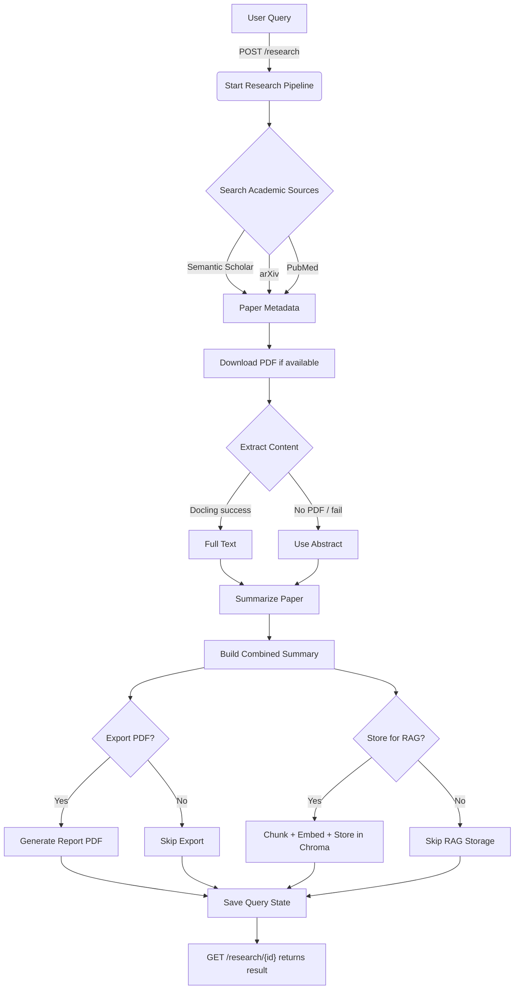
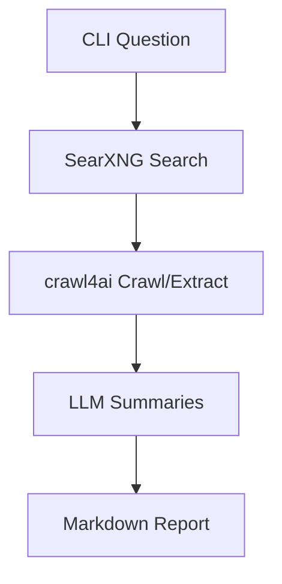

# Mini-Perplexity

Academic research assistant with two working paths:

- API pipeline for academic papers (`FastAPI`): search papers, download PDFs, extract with Docling, summarize, export PDF, optional RAG ingest.
- CLI web-research pipeline: SearXNG search + crawl4ai extraction + markdown report.

## Current Status (February 20, 2026)

Implemented now:

- FastAPI endpoints:
  - `POST /research`
  - `GET /research/{id}`
  - `POST /rag/query`
  - `GET /history`
  - `GET /export/{query_id}`
- Academic source search in API path:
  - Semantic Scholar
  - arXiv
  - PubMed
- Paper processing:
  - PDF download (when available)
  - Docling extraction (fallback to abstract)
  - Per-paper summary + combined summary
- Export:
  - PDF generation via WeasyPrint
- RAG:
  - ChromaDB collection for chunked paper content
  - Retrieval and answer generation endpoint
- Model defaults switched to:
  - `lfm2.5-thinking:latest`

## Architecture

### API Academic Pipeline (FastAPI)



### CLI Web Pipeline



Important:

- `crawl4ai` is used in the CLI web pipeline.
- `Docling` is used in the API academic-paper pipeline.

## API Endpoints

| Method | Endpoint | Description |
|---|---|---|
| POST | `/research` | Start async academic research job |
| GET | `/research/{id}` | Poll job status and result |
| POST | `/rag/query` | Ask question over stored paper chunks |
| GET | `/history` | List saved research runs |
| GET | `/export/{query_id}` | Download exported PDF |

### `POST /research` request body

```json
{
  "query": "recent findings in knowledge distillation for large language models 2024 2025",
  "options": {
    "max_papers": 5,
    "summarize": true,
    "store_for_rag": true,
    "export_pdf": true
  }
}
```

## Local Run

### Requirements

- Python 3.12+
- Ollama installed and running
- Optional for CLI web path:
  - SearXNG
  - crawl4ai

### Install

```bash
cd /home/yuguerten/workspace/mini-perplexity
python -m venv .venv
. .venv/bin/activate
pip install -e .
```

### Pull model

```bash
ollama pull lfm2.5-thinking:latest
```

### Run API

```bash
.venv/bin/python -m uvicorn src.api.main:app --host 127.0.0.1 --port 8000 --reload
```

### Run CLI

```bash
.venv/bin/python src/cli.py
```

## Real API Test

Submit:

```bash
curl -X POST "http://127.0.0.1:8000/research" \
  -H "Content-Type: application/json" \
  --data-raw '{"query":"what changed in attention mechanism from attention is all you need to now","options":{"max_papers":6,"summarize":true,"store_for_rag":true,"export_pdf":true}}'
```

Poll:

```bash
curl "http://127.0.0.1:8000/research/<QUERY_ID>"
```

## Debugging PDF Download Failures

Enable PDF URL/download debug logs:

```bash
DEBUG_PDF_DOWNLOAD=true .venv/bin/python -m uvicorn src.api.main:app --host 127.0.0.1 --port 8000 --reload
```

This logs:

- missing `pdf_url`
- attempted `pdf_url`
- HTTP status failures
- unexpected content type
- exception details

## Current Gaps

- API path is not yet restricted to Google Scholar-only discovery.
- No idempotency key on `POST /research` (retries create new `query_id`).
- Test suite is still minimal; most validation is smoke/manual.

## Storage Layout

- `data/queries/`: job state JSON
- `data/papers/`: downloaded PDFs
- `data/exports/`: generated reports
- `data/chroma/`: vector DB persistence
